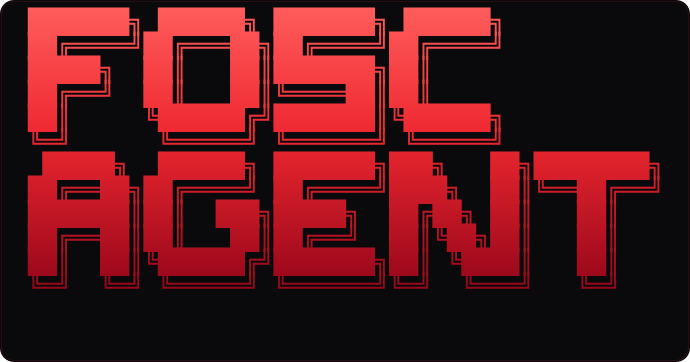
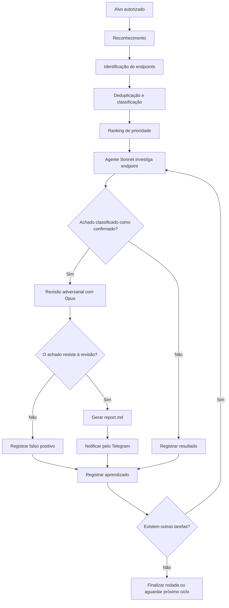
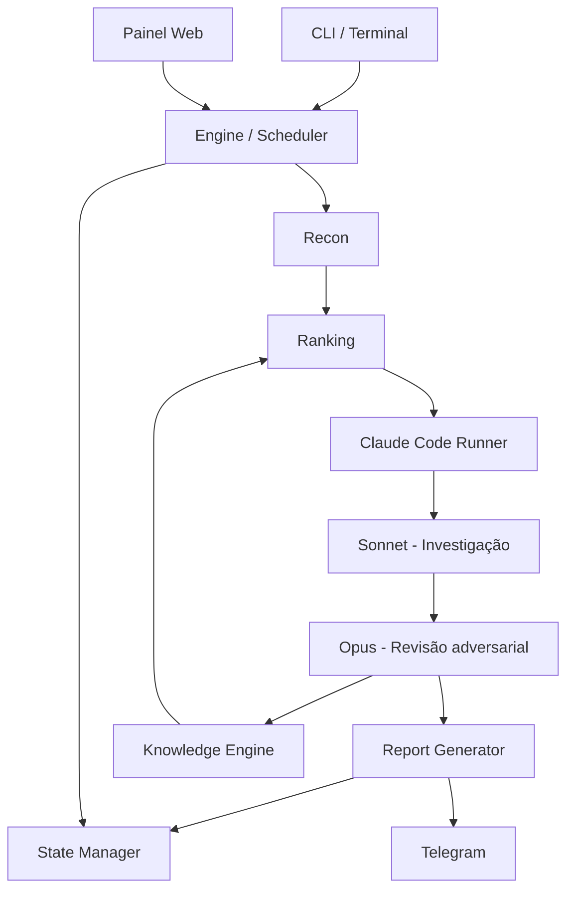

<div align="center">



### Ferramenta Ofensiva de Segurança Cibernética


**Um agente autônomo de segurança ofensiva que transforma reconhecimento em investigação, validação e documentação de vulnerabilidades.**

Construído sobre o Claude Code, o FOSC AGENT orquestra ferramentas de reconhecimento e agentes especializados para investigar superfícies de ataque, analisar endpoints e validar possíveis vulnerabilidades.

Cada achado considerado confirmado passa por uma segunda análise adversarial, conduzida por uma nova sessão do modelo Opus, cujo objetivo é tentar refutar a descoberta antes que ela seja aceita.

```text
RECON → RANKING → HUNT → VALIDATION → REPORT → LEARNING
```

[Instalação](#instalação) · [Uso](#uso) · [Arquitetura](#arquitetura) · [Painel Web](#painel-web) · [Segurança](#segurança) · [Licença](#licença)

</div>

---

> [!CAUTION]
> **Uso autorizado exclusivamente.**
>
> O FOSC AGENT deve ser utilizado apenas em sistemas próprios, laboratórios ou ativos para os quais exista autorização explícita de teste, como um contrato de pentest ou escopo formalmente definido.
>
> Cada endpoint investigado inicia uma sessão do Claude Code, que pode consumir recursos e gerar custos conforme sua assinatura e configuração. Achados classificados como confirmados também podem iniciar uma sessão adicional de revisão com o Opus.
>
> Você é responsável por definir o escopo, controlar a execução e garantir que todas as atividades estejam autorizadas.

---

## Índice

- [Visão geral](#visão-geral)
- [Como funciona](#como-funciona)
- [Recursos](#recursos)
- [Arquitetura](#arquitetura)
- [Instalação](#instalação)
- [Verificação do ambiente](#verificação-do-ambiente)
- [Uso](#uso)
- [Painel Web](#painel-web)
- [Integração com Telegram](#integração-com-telegram)
- [Aprendizado contínuo](#aprendizado-contínuo)
- [Armazenamento e estado](#armazenamento-e-estado)
- [Estrutura do projeto](#estrutura-do-projeto)
- [Testes](#testes)
- [Segurança](#segurança)
- [Licença](#licença)

---

## Visão geral

O FOSC AGENT é uma ferramenta de automação de segurança ofensiva projetada para conduzir investigações de forma contínua, organizada e orientada por evidências.

Seu objetivo é reduzir o trabalho manual entre o reconhecimento de uma aplicação e a validação de possíveis vulnerabilidades.

Em vez de executar apenas uma sequência estática de ferramentas, o FOSC coordena diferentes etapas de investigação, utiliza o Claude Code como motor de análise e mantém um histórico de conhecimento que pode influenciar futuras execuções.

O fluxo de trabalho é dividido em seis etapas:

| Etapa | Responsabilidade |
|---|---|
| Recon | Identificar a superfície de ataque e os endpoints disponíveis. |
| Ranking | Priorizar os endpoints com base em heurísticas, Nuclei e conhecimento anterior. |
| Hunt | Investigar individualmente cada padrão de endpoint. |
| Validation | Submeter achados confirmados a uma revisão adversarial. |
| Report | Gerar relatórios técnicos com evidências e passos de reprodução. |
| Learning | Registrar resultados e atualizar o conhecimento acumulado. |

## Como funciona

O funcionamento do FOSC AGENT pode ser representado pelo seguinte fluxo:



### 1. Reconhecimento

O reconhecimento constrói a superfície de ataque do alvo autorizado utilizando ferramentas externas.

O processo considera:

- Subdomínios identificados.
- Serviços HTTP disponíveis.
- Rotas e endpoints descobertos.
- URLs históricas.
- Resultados de análise do Nuclei.
- Tecnologias identificadas durante o reconhecimento.

As rotas são agrupadas por padrão. Por exemplo:

```text
/api/users/123
/api/users/456
/api/users/789
```

Podem ser tratadas como uma única tarefa de investigação:

```text
/api/users/{id}
```

Isso reduz a duplicação de trabalho e permite que a análise seja organizada por padrões de endpoint.

Assets estáticos também são descartados durante a preparação da superfície.

### 2. Ranking de prioridade

Após o reconhecimento, os endpoints passam por um sistema de classificação.

O ranking utiliza:

- Heurísticas de priorização.
- Resultados do Nuclei.
- Características da tecnologia identificada.
- Conhecimento acumulado em investigações anteriores.

O objetivo é direcionar a investigação para os endpoints com maior potencial de apresentar problemas de segurança.

### 3. Investigação autônoma

Cada padrão de endpoint é encaminhado individualmente para uma nova sessão headless do Claude Code.

O agente utiliza o modelo Sonnet para conduzir a investigação e produz uma saída estruturada contendo informações como:

- Veredito da investigação.
- Severidade.
- CVSS.
- Descrição técnica.
- Evidências encontradas.
- Passos de reprodução.
- Comandos ou requisições `curl`.
- Lições identificadas durante a análise.

Cada tarefa possui um timeout definido para evitar execuções indefinidas.

### 4. Validação adversarial

Um achado classificado como confirmado não é aceito automaticamente.

Ele passa por uma segunda sessão independente, utilizando o modelo Opus.

Essa sessão recebe a missão de questionar a descoberta, procurar inconsistências e tentar demonstrar que a vulnerabilidade não existe.

O processo funciona como uma revisão adversarial:

```text
SONNET                         OPUS
  │                              │
  ▼                              ▼
Investiga o endpoint       Tenta refutar o achado
  │                              │
  ▼                              ▼
Apresenta evidências       Analisa a descoberta
  │                              │
  └──────────┬───────────────────┘
             │
             ▼
       Resultado da revisão
          /          \
         ▼            ▼
    Sobreviveu      Refutado
         │            │
         ▼            ▼
    Confirmado    Falso positivo
         │            │
         ▼            ▼
     Relatório     Aprendizado
```

Somente os achados que sobrevivem à revisão são considerados confirmados pelo fluxo descrito. O FOSC não reexecuta por conta própria as requisições do agente: a validação é a revisão independente do Opus sobre as evidências e o PoC apresentados.

### 5. Relatórios e notificações

Os achados confirmados geram relatórios individuais em Markdown.

Os relatórios ficam organizados por alvo e tarefa, permitindo consultar as informações técnicas de cada descoberta.

Quando configurada, a integração com Telegram também envia notificações sobre os resultados.

### 6. Aprendizado

O FOSC mantém um repositório local de conhecimento em:

```text
~/.fosc/knowledge/
```

Esse conhecimento é utilizado nas investigações futuras.

O sistema registra:

- Lições de investigações bem-sucedidas.
- Falsos positivos identificados.
- Notas específicas por alvo.
- Resultados por classe de vulnerabilidade.
- Informações relacionadas às tecnologias encontradas.
- Playbook consolidado.

Com isso, o ranking pode priorizar padrões que já apresentaram resultados positivos em determinados contextos.

---

## Recursos

| Recurso | Descrição |
|---|---|
| Reconhecimento automatizado | Integração com ferramentas de descoberta e análise de superfície. |
| Deduplicação de endpoints | Agrupamento de rotas por padrão de URL. |
| Ranking inteligente | Priorização baseada em heurísticas, Nuclei e aprendizado. |
| Investigação autônoma | Uma sessão headless do Claude Code por tarefa. |
| Saída estruturada | Vereditos, severidade, CVSS, evidências e reprodução. |
| Revisão adversarial | Segunda opinião independente utilizando Opus. |
| Aprendizado local | Histórico de lições e conhecimento entre caçadas. |
| Relatórios individuais | Relatórios Markdown por achado. |
| Painel Web | Monitoramento de tarefas, resultados e agentes. |
| Dashboard de terminal | Acompanhamento pelo próprio terminal. |
| Telegram | Notificações opcionais de resultados. |
| Execução contínua | Novos ciclos de reconhecimento e investigação. |

---

## Arquitetura

O FOSC AGENT separa o gerenciamento da investigação, a execução dos agentes, o armazenamento de estado e a interface de monitoramento.



### Componentes principais

**CLI / Interface**

Responsável por receber os parâmetros, iniciar operações e permitir o gerenciamento das investigações.

**Recon**

Executa as ferramentas externas de reconhecimento e constrói a superfície de ataque.

**Ranking**

Classifica e organiza as tarefas com base nas informações coletadas e no conhecimento existente.

**Engine**

Gerencia a fila de tarefas, os workers, os ciclos de execução e os controles de pausa e parada.

**Claude Runner**

Cria e gerencia sessões headless do Claude Code, processando o formato `stream-json`.

**Verify**

Conduz a revisão adversarial com o modelo Opus.

**Knowledge**

Armazena e consolida o aprendizado entre investigações.

**Report**

Gera os relatórios técnicos individuais.

**State**

Mantém o estado persistido de cada alvo e de suas respectivas execuções.

**Webview**

Disponibiliza o painel de monitoramento por meio de um servidor Python baseado na biblioteca padrão e atualizações SSE.

**Notify**

Gerencia a integração opcional com Telegram.

---

## Instalação

### Pré-requisitos

| Dependência | Finalidade | Versão mínima |
|---|---|---|
| Python | Execução do agente | 3.11+ |
| Git | Clonagem do repositório | Qualquer versão compatível |
| Go | Instalação das ferramentas de reconhecimento | 1.21+ |
| Claude Code CLI | Motor de investigação | Instalado e autenticado |

**Sistemas de referência:** Kali Linux, Debian, Ubuntu e WSL2.

### 1. Clonar o repositório

```bash
git clone https://github.com/jvncodez/FOSC-.git fosc
cd fosc
```

### 2. Executar o instalador

O instalador automatiza a preparação do ambiente Python, instala as dependências e compila as ferramentas de reconhecimento previstas no projeto.

```bash
chmod +x scripts/*.sh
./scripts/install.sh
```

Para instalar somente o ambiente Python:

```bash
./scripts/install.sh --no-tools
```

### 3. Verificar o ambiente

Após a instalação, execute:

```bash
./scripts/doctor.sh
```

O script realiza a verificação do ambiente e das dependências necessárias.

### 4. Instalar o Claude Code CLI

O Claude Code é o motor de raciocínio e execução utilizado pelo FOSC AGENT.

Instale a CLI:

```bash
curl -fsSL https://claude.com/install.sh | bash
```

Execute o comando para realizar a autenticação:

```bash
claude
```

Confira se a instalação está funcionando:

```bash
claude --version
```

O Claude Code precisa estar instalado e autenticado antes de iniciar uma investigação.

### 5. Instalação manual

Caso prefira preparar o ambiente sem utilizar o instalador automático:

<details>
<summary><strong>Expandir instalação manual</strong></summary>

Instale as dependências de sistema:

```bash
sudo apt update
sudo apt install -y python3 python3-venv python3-pip git golang-go curl
```

Crie o ambiente virtual Python:

```bash
python3 -m venv .venv
```

Instale as dependências do projeto:

```bash
./.venv/bin/pip install -r requirements.txt
```

Habilite o executável:

```bash
chmod +x bin/fosc
```

Instale as ferramentas de reconhecimento:

```bash
go install github.com/projectdiscovery/subfinder/v2/cmd/subfinder@latest

go install github.com/projectdiscovery/httpx/cmd/httpx@latest

go install github.com/projectdiscovery/katana/cmd/katana@latest

go install github.com/projectdiscovery/nuclei/v3/cmd/nuclei@latest

go install github.com/lc/gau/v2/cmd/gau@latest

go install github.com/tomnomnom/waybackurls@latest
```

Atualize os templates do Nuclei:

```bash
nuclei -update-templates
```

Adicione o diretório das ferramentas Go ao PATH:

```bash
echo 'export PATH="$PATH:$HOME/go/bin"' >> ~/.bashrc
source ~/.bashrc
```

</details>

> [!NOTE]
> As ferramentas externas de reconhecimento são opcionais. Caso alguma não esteja disponível, o FOSC pode pular a etapa correspondente, conforme o gerenciamento implementado em `fosc/toolrunner.py`.
>
> O Claude Code CLI é a dependência obrigatória para executar as investigações.

---

## Verificação do ambiente

Antes de iniciar uma investigação, recomenda-se validar a instalação e executar os testes offline.

```bash
./scripts/doctor.sh
```

Para executar os testes principais:

```bash
.venv/bin/python -m unittest tests.test_core -v
```

O projeto utiliza um Claude falso em `tests/fake_claude.py`, capaz de emitir um fluxo `stream-json` simulado.

Isso permite testar o pipeline sem consumir sessões reais do Claude Code.

O teste cobre:

- Investigação.
- Revisão adversarial.
- Geração de relatórios.
- Registro de lições.
- Atualização do playbook.
- Pausa e parada.
- Proteções do painel.

---

## Uso

O FOSC AGENT é operado por meio da CLI localizada em `bin/fosc`.

Selecione a operação desejada e informe o alvo quando a operação exigir um alvo específico.

### Comandos principais

| Comando | Função |
|---|---|
| `-h -a alvo.com` | Executa uma investigação pontual. |
| `-h -a alvo.com --max-items 5` | Limita a primeira rodada a cinco itens. |
| `-h -a alvo.com --continuous` | Mantém a investigação contínua, realizando novo reconhecimento conforme o intervalo configurado. |
| `-c` | Abre a conversa com o FOSC AGENT (assistente de pentest). `-a` é opcional e dá contexto de um alvo. |
| `-c -a alvo.com` | Conversa com o contexto do alvo e seus achados carregados. |
| `-v -p 5555` | Inicia o painel Web na porta 5555. |
| `-w -a alvo.com` | Exibe o dashboard no terminal. |
| `-s -a alvo.com` | Consulta o estado da investigação. |
| `-r -a alvo.com --confirmed-only` | Lista achados confirmados e caminhos dos relatórios. |
| `--pause -a alvo.com` | Pausa o início de novas tarefas. |
| `--resume -a alvo.com` | Retoma a execução de novas tarefas. |
| `-x -a alvo.com` | Solicita a parada da investigação. |

### Exemplos

**Investigação pontual:**

```bash
bin/fosc -h -a alvo.com
```

**Primeira execução com limite de cinco itens:**

```bash
bin/fosc -h -a alvo.com --max-items 5
```

**Execução contínua:**

```bash
bin/fosc -h -a alvo.com --continuous
```

**Iniciar painel Web:**

```bash
bin/fosc -v -p 5555
```

**Dashboard no terminal:**

```bash
bin/fosc -w -a alvo.com
```

**Consultar o estado:**

```bash
bin/fosc -s -a alvo.com
```

**Listar somente os achados confirmados:**

```bash
bin/fosc -r -a alvo.com --confirmed-only
```

**Pausar uma investigação:**

```bash
bin/fosc --pause -a alvo.com
```

**Retomar uma investigação:**

```bash
bin/fosc --resume -a alvo.com
```

**Solicitar parada:**

```bash
bin/fosc -x -a alvo.com
```

### Opções adicionais

| Opção | Finalidade |
|---|---|
| `--workers N` | Define a quantidade de workers. Padrão: `2`. |
| `--timeout S` | Define o timeout por endpoint. Padrão: `600` segundos. |
| `--scope "..."` | Define o escopo informado para a investigação. |
| `--fresh` | Inicia a execução com a opção de estado novo. |
| `--no-nuclei` | Desativa o uso do Nuclei. |
| `--interval S` | Define o intervalo entre ciclos de reconhecimento. |
| `--no-chat` | Não abre a conversa interativa ao fim da caçada. |
| `--chat-model` | Modelo usado na conversa pós-caçada (padrão: o modelo de caça). |

### Conversa pós-caçada

Ao final de uma caçada de passo único executada no terminal, o FOSC abre uma
conversa interativa (`fosc›`) em vez de simplesmente encerrar. O alvo, o escopo
e os achados confirmados já estão no contexto, e as ferramentas ficam liberadas,
então o agente pode **testar o alvo ao vivo** durante a conversa. A continuidade
entre as perguntas é mantida pela mesma sessão do Claude Code.

```text
┌─ conversa com o FOSC AGENT  (5 achado(s) em contexto · modelo sonnet)
│  Pergunte o que quiser — ele pode testar o alvo ao vivo. Ex.: "é possível bypassar o login?"
└  Enter vazio, "sair" ou Ctrl+D encerram.

fosc› é possível bypassar o login?
```

Use `--no-chat` para desativar, ou `--chat-model opus` para conversar com um
modelo mais forte. A conversa também consome sessões do Claude Code; o custo de
cada resposta é exibido.

### Conversa a qualquer momento (`fosc -c`)

Além do fim da caçada, você pode abrir a conversa quando quiser — o FOSC AGENT
funciona como um Claude Code focado em pentest:

```bash
fosc -c                  # assistente geral: dúvidas, payloads, técnicas
fosc -c -a alvo.com      # com o alvo e seus achados no contexto
```

Sem alvo, ele responde de forma teórica e prática sem disparar requisições
contra terceiros. Com um alvo autorizado no contexto, ele pode testá-lo ao vivo.

A conversa também está no **painel web**, na aba **Conversa**: um seletor de
contexto (Geral ou um alvo), escolha de modelo (Sonnet/Opus), respostas em
streaming e as ações do agente aparecendo ao vivo. Cada conversa mantém
continuidade pela mesma sessão do Claude Code.

> [!WARNING]
> **Comece com `--max-items 5` em alvos novos.**
>
> Cada endpoint investigado pode consumir uma sessão do Claude Code. Cada achado submetido à revisão adversarial pode gerar uma sessão adicional do Opus.
>
> Monitore o consumo antes de aumentar a quantidade de itens ou ativar o modo contínuo.

---

## Painel Web

O FOSC AGENT possui uma interface Web local para acompanhar as investigações em execução.

Para iniciar:

```bash
bin/fosc -v -p 5555
```

Acesse:

```text
http://127.0.0.1:5555
```

### Login opcional com Amazon Cognito

O painel continua restrito a `127.0.0.1`. Para exigir login Cognito antes de
qualquer página, API ou feed SSE, configure um User Pool público e carregue
`.env.cognito` antes de iniciar o painel. O fluxo usa Authorization Code +
PKCE e mantém tokens fora do navegador. Siga o procedimento completo em
[`docs/cognito-local-viewer.md`](docs/cognito-local-viewer.md).

### Interface

O painel apresenta uma interface dark com identidade visual vermelha, organizada para facilitar o monitoramento das operações.

**Monitoramento**

- Sidebar com alvos em execução.
- Indicadores e cards de KPI.
- Feed de atividades dos agentes.
- Tarefas em andamento.
- Indicadores de ritmo da investigação.
- Cards de vulnerabilidades identificadas.
- Tabela filtrável de achados.

**Detalhes dos achados**

Cada achado pode ser aberto em um painel de detalhes com:

- Resumo técnico.
- Comando `curl` com opção de cópia.
- Relatório renderizado.
- Logs do agente investigador.
- Logs do agente revisor.

**Gerenciamento**

- Modal de criação de nova investigação.
- Controle para pausar operações.
- Controle para solicitar parada.
- Atualização de atividades em tempo real por SSE.

**Aprendizado**

- Indicadores de acerto por classe de vulnerabilidade.
- Informações por tecnologia.
- Playbook editável.
- Histórico de lições.

**Configurações**

- Configuração do Telegram.
- Configuração de notificações sonoras.

### Execuções independentes

As investigações iniciadas pelo painel são executadas em processos destacados.

Isso significa que fechar a interface ou interromper o processo do painel com `Ctrl+C` não encerra automaticamente uma investigação já iniciada pelo painel.

---

## Integração com Telegram

O FOSC AGENT permite configurar notificações opcionais por Telegram.

### Configuração

1. Abra o painel Web.
2. Acesse a aba **Configurações**.
3. Informe o token do bot.
4. Informe o Chat ID.
5. Clique em **Enviar teste**.

As configurações são armazenadas localmente em:

```text
~/.fosc/config.json
```

O arquivo utiliza permissões restritas:

```text
chmod 600
```

A integração é opcional. Falhas no envio de notificações não devem interromper uma investigação.

---

## Aprendizado contínuo

Uma das características do FOSC AGENT é a utilização de conhecimento acumulado entre investigações.

O sistema mantém informações locais em:

```text
~/.fosc/knowledge/
```

O conhecimento registrado pode ser utilizado pelo ranking para melhorar a priorização de endpoints em execuções futuras.

### Tipos de conhecimento

| Tipo | Objetivo |
|---|---|
| Lições positivas | Registrar padrões que resultaram em descobertas válidas. |
| Falsos positivos | Evitar repetir caminhos de investigação que foram refutados. |
| Notas por alvo | Preservar informações específicas de cada ambiente. |
| Ranking por tecnologia | Reutilizar resultados relacionados a determinadas stacks. |
| Playbook | Consolidar o conhecimento produzido pelas investigações. |

O aprendizado é local e faz parte do fluxo de priorização das investigações seguintes.

---

## Armazenamento e estado

O FOSC AGENT mantém os dados das investigações no diretório:

```text
~/.fosc/
```

Cada alvo possui uma estrutura própria de execução:

```text
~/.fosc/runs/<alvo>/
```

### Arquivos de estado

| Arquivo | Finalidade |
|---|---|
| `meta.json` | PID, status, rodada e custo. |
| `surface.json` | Superfície de ataque identificada. |
| `done.json` | Registro das tarefas concluídas. |
| `results.jsonl` | Resultados das investigações. |
| `confirmed.jsonl` | Achados confirmados. |
| `activity.jsonl` | Histórico de atividades. |
| `active.json` | Tarefas ativas. |
| `hunt.log` | Log geral da investigação. |
| `PAUSE` | Controle de pausa. |
| `STOP` | Solicitação de parada. |

### Diretórios de tarefas

Cada tarefa possui um diretório individual:

```text
tasks/<id>/
```

Dentro dele ficam informações da execução do agente, incluindo:

```text
stream.jsonl
verify.stream.jsonl
```

### Relatórios

Os relatórios individuais ficam organizados em:

```text
pocs/<id>/report.md
```

### Configurações

As configurações gerais e os dados utilizados pela integração com Telegram ficam em:

```text
~/.fosc/config.json
```

Os dados locais do FOSC não fazem parte do versionamento do repositório, conforme as regras definidas em `.gitignore`.

---

## Estrutura do projeto

```text
fosc/
│
├── bin/
│   └── fosc                  # Wrapper de execução da CLI
│
├── fosc/
│   ├── cli.py                # Interface de linha de comando
│   ├── recon.py              # Reconhecimento da superfície de ataque
│   ├── rank.py               # Ranking e priorização de endpoints
│   ├── engine.py             # Scheduler e gerenciamento de tarefas
│   ├── claude_runner.py      # Execução headless do Claude Code
│   ├── prompts.py            # Prompts e schemas estruturados
│   ├── verify.py             # Revisão adversarial com Opus
│   ├── chat.py               # Conversa interativa (terminal e painel)
│   ├── knowledge.py          # Aprendizado entre investigações
│   ├── report.py             # Geração de relatórios
│   ├── notify.py             # Integração com Telegram
│   ├── state.py              # Persistência de estado
│   ├── webview.py            # Servidor do painel Web
│   ├── toolrunner.py         # Gerenciamento defensivo de ferramentas
│   │
│   ├── web/
│   │   ├── index.html        # Estrutura da interface
│   │   ├── app.css           # Estilos
│   │   ├── app.js            # Lógica da interface
│   │   └── logo.svg          # Identidade visual
│   │
│   ├── banner.py             # Banner do terminal
│   ├── ui.py                 # Componentes de interface
│   └── tui.py                # Interface de terminal
│
├── assets/
│   └── banner.svg            # Logo do projeto
│
├── scripts/
│   ├── install.sh            # Instalação automatizada
│   └── doctor.sh             # Diagnóstico do ambiente
│
├── tests/
│   ├── fake_claude.py        # Simulação do Claude Code
│   └── test_core.py          # Testes do pipeline
│
├── requirements.txt
├── LICENSE
└── README.md
```

---

## Testes

O projeto inclui uma suíte de testes offline que exercita todo o pipeline sem consumir sessões reais do Claude Code.

```bash
.venv/bin/python -m unittest tests.test_core -v
```

Os testes utilizam `tests/fake_claude.py`, um substituto do `claude` que emite um fluxo `stream-json` com o mesmo formato do real. Com isso, recon, investigação, revisão adversarial, geração de relatório, registro de lições, consolidação do playbook, pausa/parada e as proteções do painel são verificados localmente e sem custo.

---

## Segurança

O FOSC AGENT foi projetado para executar seu painel localmente e oferecer controles para reduzir riscos durante o uso.

### Proteções do painel Web

O servidor do painel possui as seguintes proteções descritas na implementação:

| Proteção | Objetivo |
|---|---|
| Bind local | Escuta somente em `127.0.0.1`. |
| Validação de Host | Recusa cabeçalhos `Host` não locais, reduzindo riscos de DNS rebinding. |
| Proteção CSRF | POSTs exigem `X-FOSC: 1` e origem same-origin. |
| CSP | Utiliza uma Content Security Policy estrita. |
| Escape de HTML | Conteúdo originado no alvo é escapado antes de ser exibido na interface. |

### Recomendações de operação

- Utilize somente alvos autorizados.
- Defina o escopo antes de iniciar uma investigação.
- Comece com limites pequenos de execução.
- Monitore o consumo de sessões do Claude Code.
- Não compartilhe tokens ou arquivos de configuração.
- Preserve os relatórios e as evidências das investigações.
- Revise manualmente as evidências antes de utilizar os resultados em um relatório externo.

---

## Licença

O FOSC AGENT é distribuído sob a licença **MIT**.

Consulte o arquivo [LICENSE](LICENSE) para obter os termos completos de utilização, modificação e distribuição.

---

<div align="center">

**FOSC AGENT**

Ferramenta Ofensiva de Segurança Cibernética

**RECON. HUNT. VALIDATE. LEARN.**


</div>
